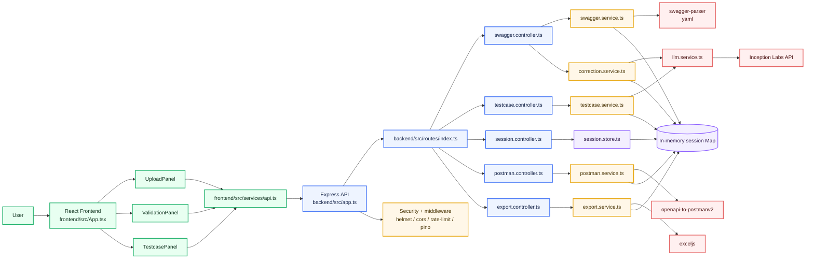

# Swagger API Testcase Generator - Beginner Architecture Guide

This document explains the project in a simple way for someone who is new to full-stack development and wants to learn how to build a similar app using vibe coding.

## What this project does

This application lets a user:

1. Upload a Swagger/OpenAPI file.
2. Validate the API specification.
3. Correct the specification if needed.
4. Generate API test cases.
5. Export results as JSON, Excel, Swagger, or Postman collection.

The project is split into two parts:

- Frontend: React app that gives the user interface.
- Backend: Express API that handles file upload, validation, generation, correction, and export.

## Technology stack

### Frontend
- React 19
- Vite
- TypeScript
- Fetch API for server calls

### Backend
- Node.js
- Express 5
- TypeScript
- Zod for request validation
- Multer for file upload
- Pino for logging
- Helmet and CORS for API security
- express-rate-limit for basic protection
- yaml and swagger-parser for OpenAPI parsing and validation
- exceljs for Excel export
- openapi-to-postmanv2 for Postman collection generation
- Inception Labs API for LLM-based correction and test generation

### Project style
- File-based modular architecture
- In-memory session storage
- API-first backend with a thin frontend
- Strong typing with shared TypeScript interfaces

## Main idea of the architecture

The frontend does not do heavy logic. It only:
- uploads the Swagger file,
- shows validation results,
- shows corrected results,
- shows generated test cases,
- triggers downloads.

The backend does the real work:
- parses the file,
- validates the OpenAPI document,
- stores session state in memory,
- calls the LLM when configured,
- generates export files.

## Beautiful data flow diagram

## End-to-end request flow

### 1. Upload Swagger file
- The user selects a `.yaml`, `.yml`, or `.json` file in `UploadPanel`.
- `frontend/src/App.tsx` sends the file through `frontend/src/services/api.ts`.
- Backend route: `POST /api/v1/swagger/upload`.
- The backend parses the file, validates it, and creates a session.
- The session id is saved in React state and used for every next action.

### 2. Validate and correct the spec
- If validation shows errors, `ValidationPanel` allows correction.
- Backend route: `POST /api/v1/swagger/correct`.
- `backend/src/services/correction.service.ts` fixes common issues.
- If LLM support is configured, `backend/src/services/llm.service.ts` may call Inception Labs for smarter correction.

### 3. Generate API test cases
- The user confirms test generation.
- Backend route: `POST /api/v1/testcases/generate`.
- `backend/src/services/testcase.service.ts` builds test cases from the spec.
- It can also use the LLM for richer generation.
- The frontend then shows the generated results in `TestcasePanel`.

### 4. Export results
- JSON export: `GET /api/v1/sessions/:sessionId/export/json`
- Excel export: `GET /api/v1/sessions/:sessionId/export/excel`
- Swagger export: `GET /api/v1/sessions/:sessionId/export/swagger`
- Postman export: `GET /api/v1/sessions/:sessionId/export/postman`
- Postman collection generation: `POST /api/v1/postman/generate`

## Which files are most important

If you are a beginner, read these files first:

### Frontend entry points
- `frontend/src/main.tsx` - starts the React app.
- `frontend/src/App.tsx` - main workflow controller for the UI.
- `frontend/src/services/api.ts` - all backend calls.
- `frontend/src/components/UploadPanel.tsx` - file upload screen.
- `frontend/src/components/ValidationPanel.tsx` - validation and correction screen.
- `frontend/src/components/TestcasePanel.tsx` - generated test case screen.

### Backend entry points
- `backend/src/server.ts` - starts the server.
- `backend/src/app.ts` - creates the Express app and middleware.
- `backend/src/routes/index.ts` - all API routes.
- `backend/src/controllers/swagger.controller.ts` - upload, validate, correct.
- `backend/src/controllers/testcase.controller.ts` - generate test cases.
- `backend/src/controllers/postman.controller.ts` - generate Postman collection.
- `backend/src/controllers/export.controller.ts` - export files.
- `backend/src/services/swagger.service.ts` - parse and validate Swagger.
- `backend/src/services/testcase.service.ts` - generate test cases.
- `backend/src/services/llm.service.ts` - LLM communication.
- `backend/src/store/session.store.ts` - in-memory session storage.

### Shared support files
- `backend/src/schemas/api.schemas.ts` - request validation.
- `backend/src/schemas/llm.schemas.ts` - validates LLM responses.
- `backend/src/utils/errors.ts` - app error type.
- `backend/src/utils/logger.ts` - logging.
- `backend/src/middleware/error-handler.ts` - central error response.

## How the code is organized

### Frontend flow
`UploadPanel` -> `App.tsx` -> `services/api.ts` -> backend API

### Backend flow
`routes/index.ts` -> controller -> service -> session store / external API -> response

This is a good pattern for beginners because each layer has one responsibility.

## Why this architecture is good for vibe coding

If you want to build a different application using vibe coding, this project is a useful reference because:

- The UI is split into small reusable components.
- The backend logic is separated from the UI.
- Every action has a clear API route.
- Types are kept in TypeScript so the frontend and backend stay aligned.
- LLM calls are isolated in one service file.
- Sessions are stored in memory, which keeps the code simple for learning.

## How to use this as a template for another project

If you want to build a different app, replace the domain-specific pieces while keeping the same structure:

- Replace Swagger upload with your own input type.
- Replace validation rules with your own business rules.
- Replace test case generation with your own output logic.
- Keep the same frontend pattern: upload screen, review screen, result screen.
- Keep the same backend pattern: route, controller, service, store, utils.

A simple reusable structure would be:

- `frontend/src/components` for UI pieces
- `frontend/src/services` for API calls
- `backend/src/routes` for API endpoints
- `backend/src/controllers` for request handlers
- `backend/src/services` for business logic
- `backend/src/store` for session or cache data
- `backend/src/schemas` for validation
- `backend/src/utils` for shared helpers

## Beginner summary

If you remember only one thing, remember this:

- The frontend shows the workflow.
- The backend performs the workflow.
- The session id connects every step together.
- The service layer is where the real logic lives.
- The app is easiest to understand by starting from `frontend/src/App.tsx` and `backend/src/routes/index.ts`.
